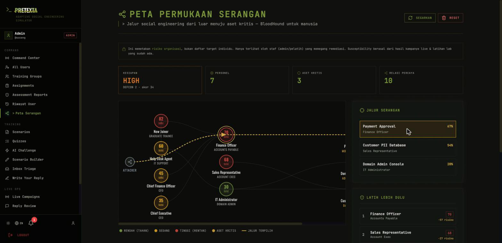
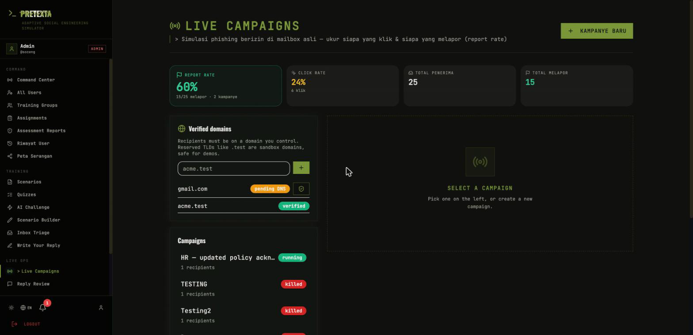
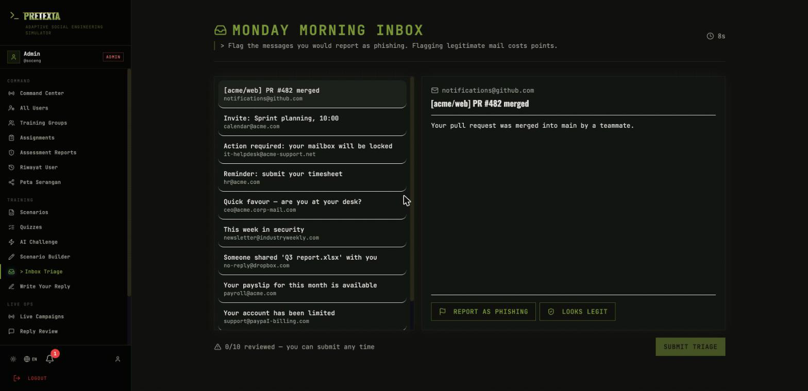
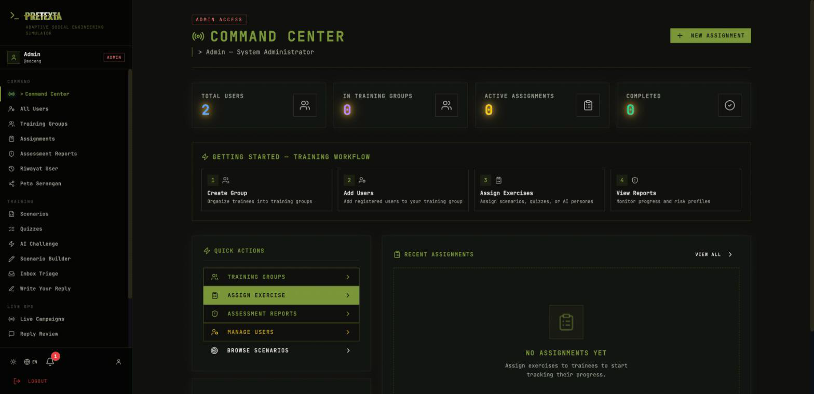
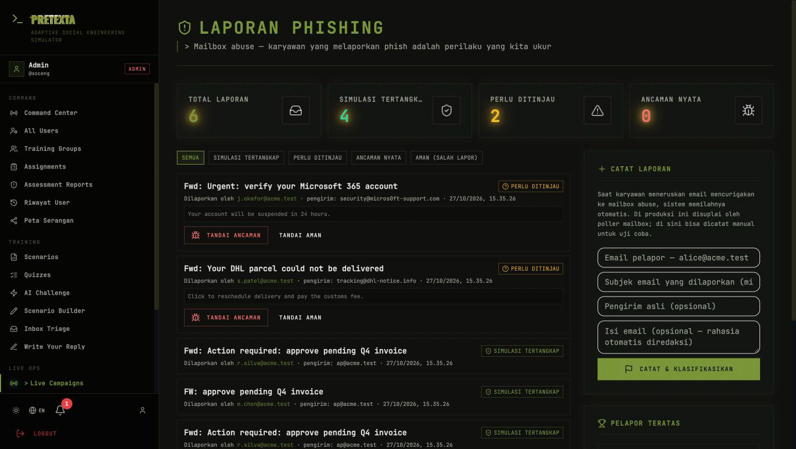
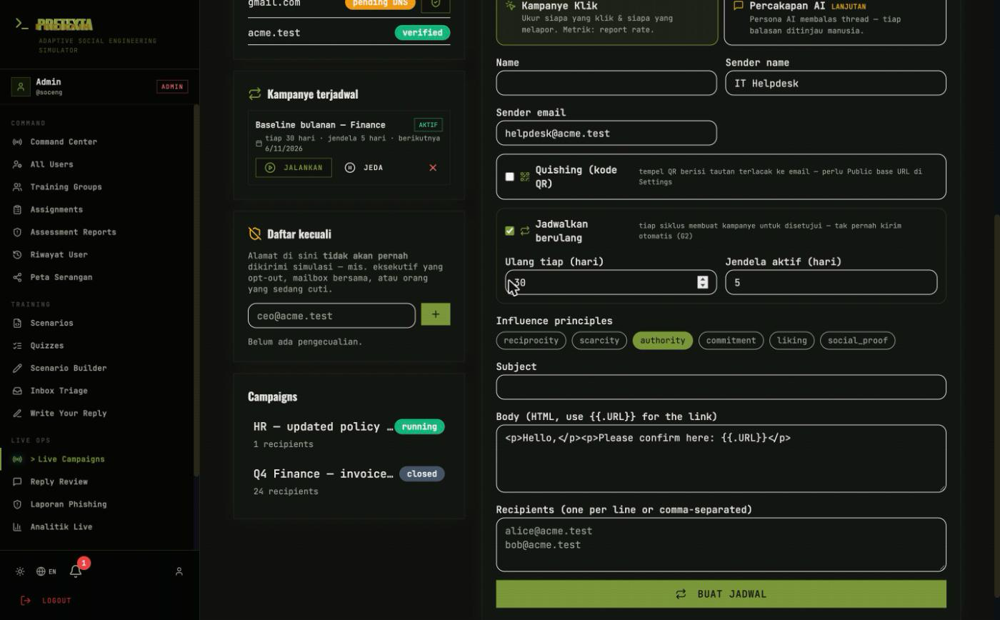
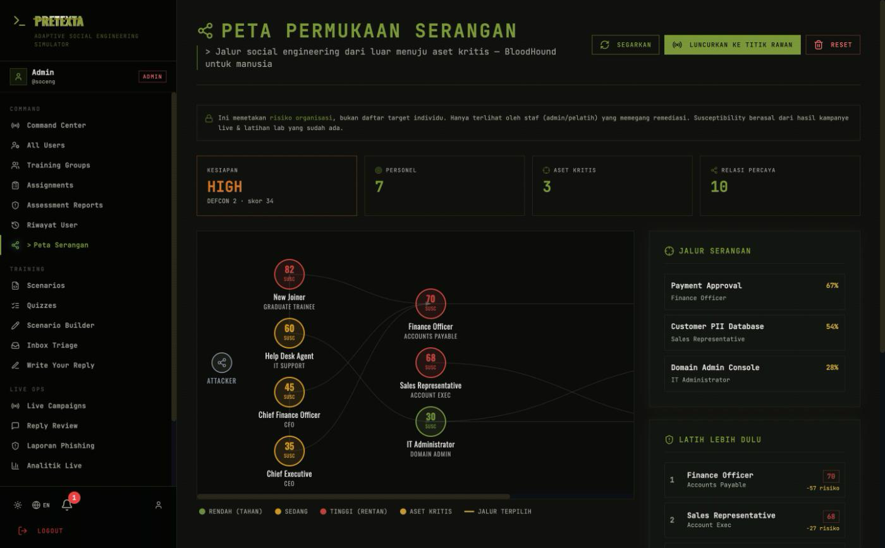
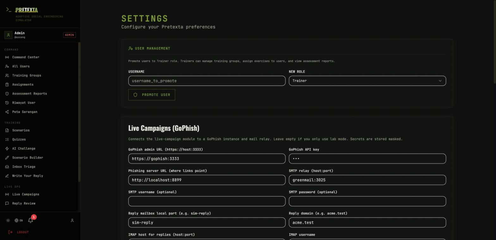

<div align="center">


### The Psychology Behind Successful Attacks
#### An Open Framework for Social Engineering Assessments

[](https://github.com/dalpan/Pretexta/releases)
[](LICENSE)
[](https://github.com/dalpan/Pretexta/actions)
[](CONTRIBUTING.md)

[Quick Start](#quick-start) · [Features](#features) · [LLM Providers](#llm-providers) · [Contributing](#contributing)

</div>

---

## Why Pretexta?

Most security tools protect systems. Pretexta protects **people**.

Social engineering is the #1 attack vector — and it doesn't exploit software. It exploits **trust, urgency, authority, and cognitive bias**. Pretexta is an open-source simulation lab where your team practices defending against these attacks in a safe, controlled environment.

Built on **Cialdini's 6 Principles of Influence**: Reciprocity, Scarcity, Authority, Commitment, Liking, and Social Proof.

Pretexta measures **what people do** under pressure, not just what they know. Two
modes: a **lab** (open-ended AI roleplay, scenarios, quizzes — all scored on the
server so results can't be gamed) and **live campaigns** (authorized phishing in
real mailboxes via GoPhish, with an AI persona that continues the thread and
stops before any real secret is disclosed). The primary live metrics are
**report rate** and **time-to-report**, not click rate alone. See
[docs/concept.md](docs/concept.md).

## Screenshots

**Human Attack Surface Map** — a defensive "BloodHound for people." The highlighted
route is the easiest path an attacker could walk from the outside to a crown jewel.



**Live Campaigns** — report rate leads the dashboard, not click rate.



<details>
<summary><strong>Inbox Triage</strong> — signal-detection exercise (spot phish among legitimate mail)</summary>



</details>

<details>
<summary><strong>Command Center</strong> — the trainer/admin operations view</summary>



</details>

<details>
<summary><strong>Report-Phish Inbox</strong> — forwarded phish, auto-classified; reporters credited</summary>



</details>

<details>
<summary><strong>Recurring schedules + quishing</strong> — a campaign on a cadence, or delivered as a QR code</summary>



</details>

<details>
<summary><strong>Launch from the Attack Surface Map</strong> — one click targets the human weak points</summary>



</details>

<details>
<summary><strong>Settings</strong> — GoPhish + mail-relay wiring for live mode (secrets stored masked)</summary>



</details>

## Quick Start

```bash
git clone https://github.com/dalpan/Pretexta.git
cd Pretexta
make build && make up       # Creates .env with random secrets, builds and starts services
```

Open [http://localhost:9443](http://localhost:9443) and log in as `soceng` with the admin password
printed by `make build` (also stored in `.env` as `SEED_ADMIN_PASSWORD`).

> Pretexta never ships default credentials. If you write `.env` yourself and leave
> `SEED_ADMIN_PASSWORD` empty, the backend generates one and prints it once in `make logs-backend`.

> **Requires:** Docker + Docker Compose (or Docker Desktop)

### Troubleshooting: WSL2 Docker Network Error

If you see `connect: network is unreachable` or `failed to fetch anonymous token`, this is a WSL2 IPv6 issue:

```bash
# Option 1: Automated fix
bash scripts/fix-wsl2-network.sh

# Option 2: Manual fix
sudo bash -c 'echo "{\"dns\":[\"8.8.8.8\",\"8.8.4.4\"],\"ipv6\":false}" > /etc/docker/daemon.json'
sudo bash -c 'echo "nameserver 8.8.8.8" > /etc/resolv.conf'
sudo service docker restart
make build
```

### Local Development (without Docker)

```bash
make install      # Install frontend + backend dependencies
make dev          # Start MongoDB in Docker, run app locally
```

Backend runs at `localhost:8001` with hot-reload. Frontend runs at `localhost:3000`.

## Features

### Live campaigns — the headline

Authorized phishing in real mailboxes via **GoPhish**. The primary flow is a
**click campaign**: send a lure and measure behaviour — who clicks, and the
metric that actually matters, **who reports it**. Report rate, click rate and
median time-to-report lead the dashboard.

| Capability | What it does |
|---|---|
| **Report-rate first** | Measures the defensive behaviour that matters, not clicks alone |
| **Two-person approval** | A second admin must approve every campaign before launch (G2) |
| **Domain verification** | Recipients must be on a domain you control (DNS TXT) or a `.test` sandbox |
| **Kill switch** | Stops all in-flight sending immediately (G4) |
| **No credential capture** | Landing pages are teachable moments — never password forms (G5) |
| **Optional AI conversation** | A persona can continue a reply thread toward one approved objective — every reply **held for human review**, secrets redacted before storage (G6–G8) |
| **Hash-chained audit log** | Every state change is tamper-evident (G9) |
| **Recurring schedules** | Run a baseline and periodic retests; each run is created in *pending_approval*, never auto-sent (G2) |
| **Quishing (QR)** | Deliver the lure as a QR code encoding the tracked URL — a scan is attributed like a click |
| **Launch from the map** | One click seeds a campaign with the most-susceptible people from the Human Attack Surface Map |

See [guardrails.md](docs/guardrails.md) for the full G1–G15 set.

### Report-Phish inbox (the defensive mirror)

Reporting a phish is the behaviour we actually want — so Pretexta measures it on
both sides. When someone forwards a suspicious email to the abuse mailbox, the
server classifies it: if it's one of **our** simulations it **credits the
reporter** (which flows straight into that campaign's report rate); if it isn't,
it's queued as *needs review* so the security team can flag a genuine threat.
A reporter leaderboard surfaces the people actively defending the organization.

### The remediation loop

Pretexta is a closed loop, not a pile of exercises: **measure → remediate →
retest**. When someone fails — a live click or a failed lab exercise — the server
automatically assigns targeted practice for the exact Cialdini principle they
fell for, then schedules a variant retest to confirm the lesson stuck.

### Human Attack Surface Map

A defensive **"BloodHound for people."** Model the organization as people, trust
relationships, and crown-jewel assets (money, admin, data); overlay real
susceptibility from campaign and lab results; then compute the easiest
social-engineering path to each asset and the highest-leverage person to train
first. Privacy-first — it maps organizational risk, not a hit-list (G13).

### Lab exercises — all scored on the server

Clients can't forge a score or read an answer key; grading is server-authoritative.

| Exercise | What it measures |
|---|---|
| **Inbox Triage** | Signal-detection (d′) — spotting phish among legitimate mail |
| **Write Your Reply** | A free-text reply to a lure, graded against an LLM rubric |
| **Branching scenarios** | Decisions under pressure, scored per choice |
| **AI chat roleplay** | Open-ended conversation with an adversarial persona |
| **Quizzes** | Knowledge checks |

### Behavioural risk profiling

A per-person **risk vector** across Cialdini's six principles, updated from
demonstrated behaviour (never auto-decremented). It feeds both the remediation
loop and the attack-surface map.

### Teams & organizations

Organizations with invite codes, training groups, assignments, and aggregate
(cohort-only) analytics for trainers and admins. Gamification (XP, badges,
streaks, leaderboard) exists for the lab but **never reads live-campaign data** (G15).

### Content tools & platform

| Feature | Description |
|---------|-------------|
| **Scenario Builder** | Visual editor for custom branching scenarios |
| **YAML Import** | Bulk-import scenarios and quizzes from YAML |
| **Bilingual** | Full English and Bahasa Indonesia |
| **Military command theme** | Dark operations-room UI |
| **Multi-provider LLM** | Six providers — see below |
| **Platform** | Server-authoritative scoring everywhere, notifications, error boundary, PWA-installable |

## LLM Providers

Pretexta supports **6 LLM providers** with model selection. Configure in **Settings**.

| Provider | Models | Free Tier | Best For |
|----------|--------|-----------|----------|
| **OpenRouter** | 200+ (Llama, GPT, Claude, Mistral, DeepSeek, Qwen) | Yes | Best value, most models |
| **Groq** | Llama 3.3 70B, Mixtral, Gemma | Yes | Fastest inference |
| **Google Gemini** | Gemini Flash / Pro | Yes | Generous free limits |
| **OpenAI** | GPT-4o / GPT-4o mini / o-series | No | Industry standard |
| **Anthropic** | Claude Sonnet / Haiku | No | Best reasoning |
| **Local LLM** | Any model via Ollama / LM Studio / llama.cpp | N/A | Full privacy, no API key |

> **Recommended**: Start with **OpenRouter** (free models available) or **Groq** (ultra-fast free tier).

### Local LLM Setup

```bash
# Ollama
ollama serve
ollama pull llama3.1

# Then in Pretexta Settings → Local LLM → http://localhost:11434/v1
```

Also supports **LM Studio** (port 1234) and **llama.cpp** (port 8080).

## Architecture

```
┌─────────────────────────────────────────────────┐
│                   Frontend                      │
│         React 19 · Tailwind · Recharts          │
│              localhost:9443                     │
└──────────────────┬──────────────────────────────┘
                   │ REST API
┌──────────────────┴──────────────────────────────┐
│                   Backend                       │
│     FastAPI · LangChain · Pydantic · JWT        │
│              localhost:9442                     │
│                                                 │
│  routes/    services/    models/    middleware/ │
│  ├── auth        ├── llm        schemas.py      │
│  ├── challenges  ├── gamification               │
│  ├── campaigns   ├── adaptive                   │
│  ├── leaderboard ├── scoring                    │
│  ├── analytics   └── database                   │
│  ├── debrief                                    │
│  ├── certificates                               │
│  ├── notifications                              │
│  ├── webhooks                                   │
│  └── scenario_builder                           │
└──────────────────┬──────────────────────────────┘
                   │
┌──────────────────┴──────────────────────────────┐
│                  MongoDB 7.0                    │
│              localhost:47017                    │
└─────────────────────────────────────────────────┘
```

## API Overview

<details>
<summary><strong>30+ REST Endpoints</strong> (click to expand)</summary>

| Group | Endpoints |
|-------|-----------|
| **Auth** | `POST /register`, `POST /login`, `GET /me`, `PUT /profile`, `POST /change-password` |
| **Challenges** | `GET /challenges`, `GET /challenges/:id`, `POST /challenges` |
| **Quizzes** | `GET /quizzes`, `GET /quizzes/:id` (answer key stripped), `POST /quizzes/:id/submit` |
| **Scenarios** | `POST /scenarios/start`, `POST /scenarios/choose`, `POST /scenarios/resume` |
| **Live Campaigns** | `CRUD /live/campaigns`, `/submit`, `/approve`, `/launch`, `/kill`, `/sync`, `/review`, `/audit` |
| **Simulations** | `CRUD /simulations` |
| **LLM / AI chat** | `GET /providers`, `GET /models/:provider`, `POST /config`, `POST /generate`, `POST /chat/start`, `POST /chat/turn` |
| **Campaigns** | `GET /campaigns`, `POST /start`, `POST /stage/:idx/complete` |
| **Leaderboard** | `GET /leaderboard`, `GET /me`, `GET /badges` |
| **Analytics** | `GET /personal`, `GET /team` |
| **Organizations** | `POST /create`, `GET /mine`, `POST /join`, `DELETE /leave` |
| **Debrief** | `GET /:simulation_id`, `POST /:simulation_id/ai-analysis` |
| **Certificates** | `GET /:simulation_id`, `GET /user/all` |
| **Notifications** | `GET /`, `PUT /:id/read`, `PUT /read-all` |
| **Webhooks** | `CRUD /webhooks` |
| **Scenario Builder** | `CRUD /templates`, `POST /publish` |
| **Adaptive** | `GET /difficulty`, `GET /persona-params` |
| **Health** | `GET /health` |

All endpoints prefixed with `/api`. Full OpenAPI docs at `/docs` when running.

</details>

## Development

```bash
# Install locally (without Docker)
make install

# Lint backend
make lint          # Check
make lint-fix      # Auto-fix

# Run tests
make test

# View logs
make logs
make logs-backend
make logs-frontend

# Database
make db-shell      # MongoDB shell
make drop          # Clear sample data
make clean         # Remove containers + volumes
```

### Adding a Scenario

Create a YAML file in `data/sample/`:

```yaml
type: challenge
title: "The Fake Recruiter"
description: "A headhunter offers your dream job..."
difficulty: medium
cialdini_categories: [liking, reciprocity]
estimated_time: 10
metadata:
  author: "Your Name"
  tags: [phishing, recruitment]
nodes:
  - id: start
    type: message
    channel: email_inbox
    content_en:
      subject: "Exciting VP Opportunity"
      from: "sarah@techcorp-careers.com"
      body: "Hi! I found your profile and I'm impressed..."
  - id: choice_1
    type: question
    content_en:
      text: "What do you do?"
    options:
      - text: "Open the attached resume PDF"
        next: end_compromised
        score_impact: -20
      - text: "Verify the recruiter's identity first"
        next: end_safe
        score_impact: 20
```

Run `make seed` to import.

Or use the **Scenario Builder** in the UI for a visual editor.

## Documentation

Full documentation lives in [`docs/`](docs/):

- [User Guide / Rule Book](docs/user-guide.md) — install, usage (admin & trainee), every menu with screenshots
- [Live Campaign Walkthrough](docs/live-campaign-walkthrough.md) — set up GoPhish and run a full live campaign, step by step
- [Concept](docs/concept.md) — why Pretexta measures behavior, not knowledge
- [Architecture](docs/architecture.md) · [Scoring & anti-cheat](docs/scoring.md) · [Guardrails](docs/guardrails.md)
- [Live campaigns design](docs/design/live-campaigns.md) · [API](docs/api.md) · [Deployment](docs/deployment.md)

## Contributing

We welcome contributions! See [CONTRIBUTING.md](CONTRIBUTING.md) for guidelines.

**Ways to contribute:**
- Add new social engineering scenarios (YAML or Scenario Builder)
- Improve AI persona behaviors
- Add new Cialdini-based analysis rules
- Translate to more languages
- Report bugs and suggest features

## Ethics

Pretexta is for **authorized defensive training and research**. It has two modes
with different footprints:

- **Lab mode** — fictional, self-contained simulations. No real targeting, no
  live infrastructure.
- **Live mode** — authorized phishing simulations in an organization's own
  mailboxes. Gated by enforced guardrails: recipients must be on a verified
  domain, campaigns need two-person approval and a kill switch, landing pages
  never capture passwords, secrets typed into replies are redacted before
  storage, coercive and brand-impersonation themes are blocked, and every action
  is written to a tamper-evident audit log.

Read [docs/ethics.md](docs/ethics.md) and [docs/guardrails.md](docs/guardrails.md)
before running live campaigns. Use responsibly. Train defenders, not attackers.

## License

[MIT License](LICENSE)

---

<div align="center">

**Pretexta** — *Understanding why social engineering works, before attackers do.*

</div>
