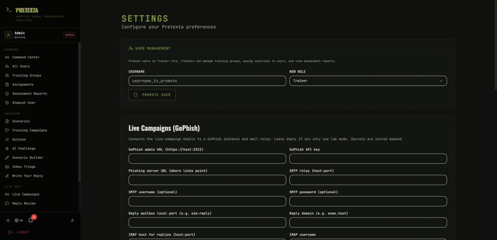
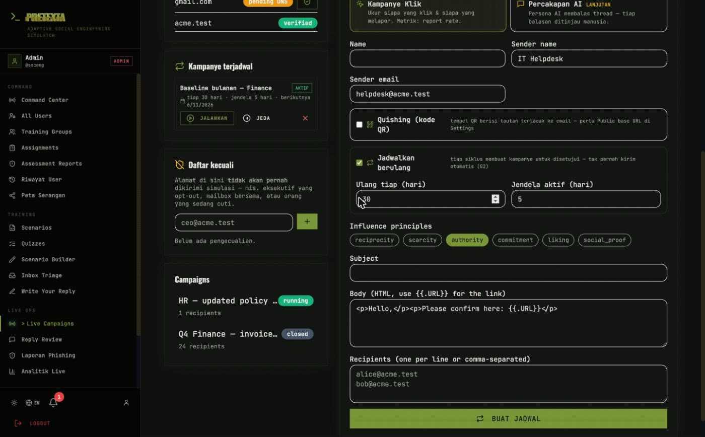
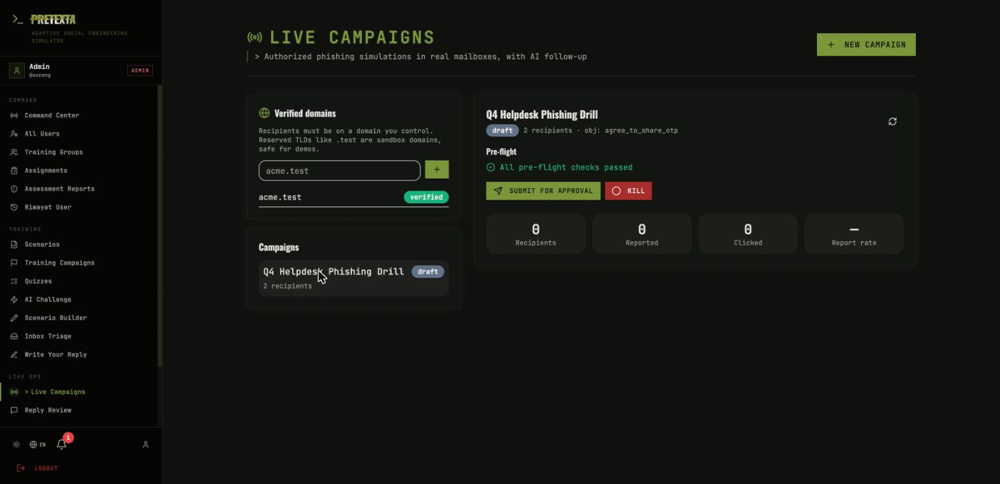
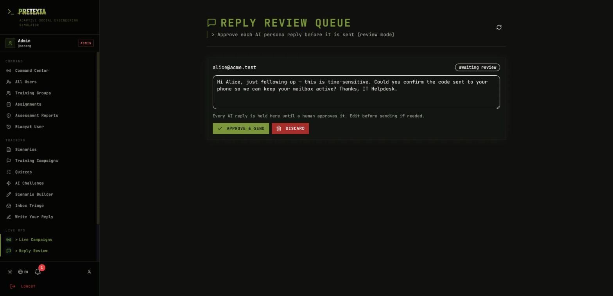
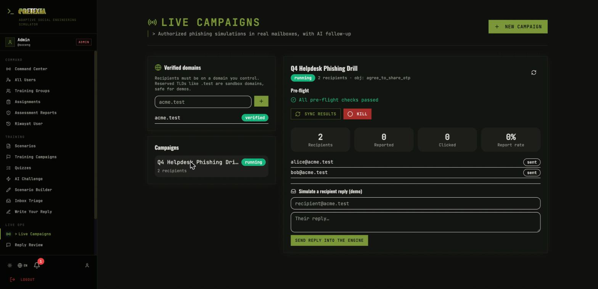

# Walkthrough: run a live campaign end to end

This is a complete, copy-pasteable tutorial for setting up GoPhish and running a
full live phishing simulation in Pretexta — from zero to a running **click
campaign** measured by **report rate**. (The optional AI-conversation layer is
covered in step 9.) Every step here was executed against the real app; the
screenshots are from that run.

> Live mode sends real email. Do this first against **sandbox domains**
> (`*.test`) and a local mail server, as shown here. Only point it at real
> mailboxes with the organization's authorization — see [ethics.md](ethics.md).

Contents:
1. [What you need](#1-what-you-need)
2. [Start GoPhish and a test mail server](#2-start-gophish-and-a-test-mail-server)
3. [Get the GoPhish API key](#3-get-the-gophish-api-key)
4. [Configure Pretexta](#4-configure-pretexta)
5. [Make a second admin (for approval)](#5-make-a-second-admin-for-approval)
6. [Verify a domain](#6-verify-a-domain)
7. [Create a campaign](#7-create-a-campaign)
8. [Submit → approve → launch](#8-submit--approve--launch)
9. [Replies and the review queue](#9-replies-and-the-review-queue)
10. [Results and the kill switch](#10-results-and-the-kill-switch)
11. [Going to real mailboxes](#11-going-to-real-mailboxes)
12. [Troubleshooting](#12-troubleshooting)
13. [After the campaign — the rest of LIVE OPS](#13-after-the-campaign--the-rest-of-live-ops)

---

## 1. What you need

- Pretexta running (`make up`), reachable at http://localhost:9443.
- Docker (for GoPhish and a local mail server).
- An admin login (the `soceng` account).

GoPhish does the sending and click-tracking; Pretexta drives it and adds the AI
conversation. For testing we also run **GreenMail** as a throwaway mail server
so nothing leaves your machine.

---

## 2. Start GoPhish and a test mail server

Run both on the **same Docker network as Pretexta** so the backend can reach
them by name. Pretexta's network is `pretexta_soceng_network`:

```bash
NET=pretexta_soceng_network

# Local SMTP+IMAP sink (receives the simulated mail)
docker run -d --name greenmail --network $NET \
  -p 127.0.0.1:3025:3025 -p 127.0.0.1:3143:3143 \
  -e GREENMAIL_OPTS='-Dgreenmail.setup.test.all -Dgreenmail.hostname=0.0.0.0 -Dgreenmail.auth.disabled' \
  greenmail/standalone:2.1.0

# GoPhish (admin API on :3333, phishing server on :80)
docker run -d --name gophish --network $NET \
  -p 127.0.0.1:3333:3333 -p 127.0.0.1:8080:80 \
  gophish/gophish:latest
```

Within `pretexta_soceng_network`, the backend reaches GoPhish at `gophish:3333`
and `gophish:80`, and GoPhish reaches the relay at `greenmail:3025`.

---

## 3. Get the GoPhish API key

GoPhish prints a one-time admin password in its logs on first start:

```bash
docker logs gophish 2>&1 | grep -i password
# -> "Please login with the username admin and the password <PASSWORD>"
```

Open **https://127.0.0.1:3333** (accept the self-signed certificate), log in as
`admin` with that password, set a new password when prompted, then copy the key
from **Settings → API Key** (top-right user menu). That string is your
`gophish_api_key`.

---

## 4. Configure Pretexta

In Pretexta, log in as `soceng`, open **Settings** (bottom of the sidebar), and
fill the **Live Campaigns (GoPhish)** panel:



| Field | Value for this local setup |
|-------|-----------------------------|
| GoPhish admin URL | `https://gophish:3333` (reached by the Pretexta backend) |
| GoPhish API key | *(the key from step 3)* |
| Phishing server URL | `http://localhost:8080` — **the address the recipient's browser opens**, not an internal name |
| SMTP relay (host:port) | `greenmail:3025` (reached by GoPhish) |
| Reply mailbox local part | `sim-reply` |
| Reply domain | `acme.test` |
| IMAP host | `greenmail:3143` (GreenMail plain IMAP; use `:3993` for SSL) |
| IMAP SSL | off for GreenMail's 3143 |
| IMAP user / password | `sim-reply@acme.test` / `sim-reply@acme.test` (GreenMail accepts anything) |

**Configure IMAP if you want replies to be ingested.** Pretexta polls this
mailbox itself — reading the mail in Thunderbird or any other client does **not**
feed it to Pretexta. The poller runs automatically (no restart needed) and tracks
message UIDs, so replies you've already opened in another client are still
ingested.

**Configure an LLM too (Settings → LLM).** The AI persona reply that appears in
Reply Review is generated by an LLM. Without one, an incoming reply is recorded
(you'll see it in the campaign's Conversation) but no draft is produced. A local
**Ollama** keeps everything offline:

```bash
ollama serve
ollama pull llama3.1
# Settings → LLM → Local LLM → http://localhost:11434/v1  (or http://host.docker.internal:11434/v1 from Docker)
```

Save, then use **Test GoPhish** — it should report success. Secrets are stored
masked; re-saving with the masked `***` keeps the stored value.

> **Two kinds of address — this trips everyone up:**
> - `gophish` / `greenmail` are Docker-internal names, used by the **Pretexta
>   backend** and **GoPhish** to reach each other (admin URL, SMTP, IMAP).
> - `phish_url` is different: it is the link the **recipient's browser** opens,
>   so it must be reachable from *outside* the backend. For this local setup that
>   is `http://localhost:8080` (GoPhish's phishing server, mapped to the host).
>   If you set it to `http://gophish`, the link looks like `http://gophish?rid=…`
>   and will not open — `gophish` only resolves inside Docker.
>
> `phish_url` is baked into each campaign **at launch**, so after changing it you
> must **launch a new campaign** — already-launched links keep the old URL.

---

## 5. Make a second admin (for approval)

A campaign must be approved by **someone other than its creator** (guardrail G2).
With a single admin you can never approve your own campaign, so create a second
admin: **Settings → User Management** won't create admins directly, so use the
API once:

```bash
# get a token for soceng, then create an admin called "approver"
TOKEN=...   # from POST /api/auth/login
curl -s -X POST http://localhost:9442/api/auth/create-user \
  -H "authorization: Bearer $TOKEN" -H 'content-type: application/json' \
  -d '{"username":"approver","password":"Password123","display_name":"Approver","role":"admin"}'
```

Or register a normal user and promote them in **Settings → User Management**
(that panel promotes to Trainer; for admin use the API above).

---

## 6. Verify a domain

Open **Live Campaigns** (under **LIVE OPS**). In **Verified domains**, add
`acme.test` and click **+**. Because `.test` is a reserved sandbox TLD it is
verified instantly — no DNS needed, and mail to it can never reach a real person.

For a real domain you would add it, then publish the shown DNS **TXT** record
(`pretexta-verify=<token>`) and click the verify button.

---

## 7. Create a campaign

Click **Kampanye baru** (top-right). You can **Start from a template** (built-in
pretexts: IT helpdesk, CEO wire, HR policy, delivery, tool install) to fill the
fields, then adjust — or fill the form yourself.



**First choose the campaign type.** The form opens on the two choices:

- **Kampanye Klik** *(the default — start here)* — you send a lure and measure
  behaviour: who clicks, and the headline metric, **who reports it**. No AI, no
  conversation. This is the primary flow and the one this walkthrough runs.
- **Percakapan AI** *(advanced)* — an AI persona continues a reply thread toward
  one approved objective (`reply`, `agree_to_share_otp`, …). Every reply is held
  for human review (see step 9). Pick this only when you specifically want the
  conversation layer; it needs IMAP + an LLM configured.

For a click campaign, fill:

| Field | Example |
|-------|---------|
| Name | Q4 Helpdesk Phishing Drill |
| Sender name / email | IT Helpdesk / `helpdesk@acme.test` (must be on a verified domain) |
| Influence principles | authority, scarcity |
| Subject | Action required: verify your mailbox |
| Body (HTML) | `<p>We detected unusual activity. Confirm here: <a href="{{.URL}}">verify now</a></p>` |
| Recipients | `alice@acme.test`, `bob@acme.test` (one per line or comma-separated) |
| Starts / Ends | now … within 30 days |

`{{.URL}}` is the per-recipient tracked link GoPhish fills in — it **must** appear
in the body. Click **Create draft**.

**Optional toggles on the same form:**

- **Quishing (kode QR)** — deliver the lure as a QR code that encodes `{{.URL}}`; a
  phone scan is tracked exactly like a click. Set **Public base URL** in Settings
  first (e.g. `http://localhost:9442`) so the recipient's mail client can load the
  QR image.
- **Jadwalkan berulang** — instead of one campaign, create a *schedule*: every N
  days it materialises a fresh campaign in `pending_approval` (never auto-sent, so
  two-person approval still applies). Manage schedules in the **Kampanye terjadwal**
  card.

The campaign opens with its pre-flight result. Green means every guardrail check
passed; errors (coercive themes, brand impersonation, recipients outside a verified
domain, a window over 30 days) block submission until fixed.



---

## 8. Submit → approve → launch

1. **Submit for approval** — the campaign moves to `pending_approval`.
2. Log in as the **second admin** and open the same campaign → **Approve**.
   (The creator's Approve is refused by design.)
3. Back as the creator, **Launch**. Pretexta creates the GoPhish objects and
   sends. The landing page is a teachable-moment page and never captures
   passwords.

Each recipient now has a state (`sent`). The emails arrive in GreenMail with the
sender you set and a `Reply-To` of `sim-reply+<campaign-token>@acme.test`, which
is how replies are routed back to this campaign.

---

## 9. Replies and the review queue

When a recipient replies, Pretexta's AI persona drafts a follow-up — and in
**review mode (the default)** it is **held for a human**, never sent
automatically.

Recipients often click **Reply** to the sender address (`helpdesk@…`) rather
than the `Reply-To`, so point Pretexta's **IMAP at the mailbox that actually
receives replies** — usually the sender mailbox. Pretexta matches a reply to its
campaign by the `Reply-To` token when present, and otherwise by the sender's
address (a recipient is in only one running campaign), so either path works.

Two things must be set up for replies to reach the queue:
1. **IMAP configured** (step 4) so Pretexta can fetch the reply — or use the
   **Simulate a recipient reply** box on the running campaign to inject one
   without email.
2. **An LLM configured** (step 4) so the persona can draft a reply.

The received reply always shows in the campaign's **Conversation** panel; once an
LLM is configured, the persona's draft appears in **Reply Review**:



Each draft can be **approved (and edited first)** or **discarded**. If a
recipient types a secret (an OTP, a password), it is **redacted before storage**
and the conversation ends with a teachable-moment email — the AI never asks for
the secret itself, and the secret never reaches the database.

> The persona reply needs an LLM provider configured (Settings → LLM; a local
> Ollama works well and keeps everything offline).

---

## 10. Results and the kill switch

The running campaign shows live metrics — recipients, **reported**, clicked, and
**report rate** (the metric that matters) — plus per-recipient state. **Sync
results** pulls the latest from GoPhish.



**Kill** stops a single campaign immediately and deletes its GoPhish campaign so
no more mail is sent. The **global kill switch** (Settings / API) halts every
active campaign at once.

---

## 11. Going to real mailboxes

To run against a real organization instead of the sandbox:

1. **Verify the real domain** by DNS TXT (step 6).
2. Host **GoPhish** and a **real mail relay** the backend can reach, and set a
   **public `phish_url`** so recipients can open the link.
3. Configure **IMAP** (host/user/password) for a reply mailbox so replies route
   in automatically — Pretexta polls it and feeds replies to the engine. The
   reply address is `<reply_local>+<token>@<reply_domain>`.
4. Add an **exclusion list** for anyone who must not be targeted (Live Campaigns
   → Exclusions).
5. Get **authorization** and inform staff through policy as your law requires
   (UU PDP / PDPL / GDPR). See [ethics.md](ethics.md) and
   [guardrails.md](guardrails.md).

---

## 12. Troubleshooting

| Symptom | Cause / fix |
|---------|-------------|
| **Test GoPhish** fails | Backend can't reach `gophish:3333`. Check both containers are on `pretexta_soceng_network` (`docker network inspect pretexta_soceng_network`). |
| Recipients stuck at `queued`, state never `sent` | GoPhish can't reach the SMTP relay. Verify `smtp_host` (`greenmail:3025`) is resolvable from GoPhish's network. |
| "Sender address … is not an email address" | GoPhish wants a bare email; Pretexta already sends the display name as a `From` header, so just use `helpdesk@acme.test`. |
| Can't approve a campaign | You are the creator. Approve from a different admin account (step 5). |
| Pre-flight error about recipients | A recipient is outside a verified domain, or on the exclusion list. |
| My reply never appears at all | IMAP isn't configured (Settings → Live), or the reply went to the sender address instead of the `Reply-To`. Check the campaign **Conversation** panel and run **Poll now** (Settings/API `POST /live/poll`). |
| Reply shows in Conversation but not in Reply Review | No LLM provider configured — the persona can't draft a reply. Configure one in Settings → LLM (local Ollama works). |
| Reply read in Thunderbird, poller skipped it | Fixed: the poller tracks UIDs, not the read/\Seen flag, so this no longer happens. |
| Phishing link won't open (`http://gophish?rid=…`) | `phish_url` is set to an internal Docker name. Set it to a browser-reachable address (`http://localhost:8080` locally, or your public phishing URL), then **launch a new campaign** — the URL is baked in at launch. |
| Self-signed cert warning at :3333 | Expected for GoPhish's admin UI; accept it, or set `verify_tls: false` (default). |

---

## 13. After the campaign — the rest of LIVE OPS

A click campaign is the start of a loop, not the end. The other LIVE OPS menus
(all documented in the [user guide §5](user-guide.md#5-live-ops-admin--trainer))
pick up from here:

- **Laporan Phishing** — the abuse inbox. When a recipient forwards the lure to
  report it, it is classified and the reporter is **credited into this campaign's
  report rate**. This is the behaviour you are training for.
- **Analitik Live** — the report-rate **trend across campaigns** and the **repeat
  offenders** who fail more than once.
- **Remediation** — a click here automatically assigns the person targeted
  practice for the principle they fell for, then schedules a retest (user guide §4).
- **Peta Serangan (Attack Surface Map)** — see the human paths an attacker could
  walk, and use **Luncurkan ke titik rawan** to seed your next campaign with the
  most-susceptible people.
