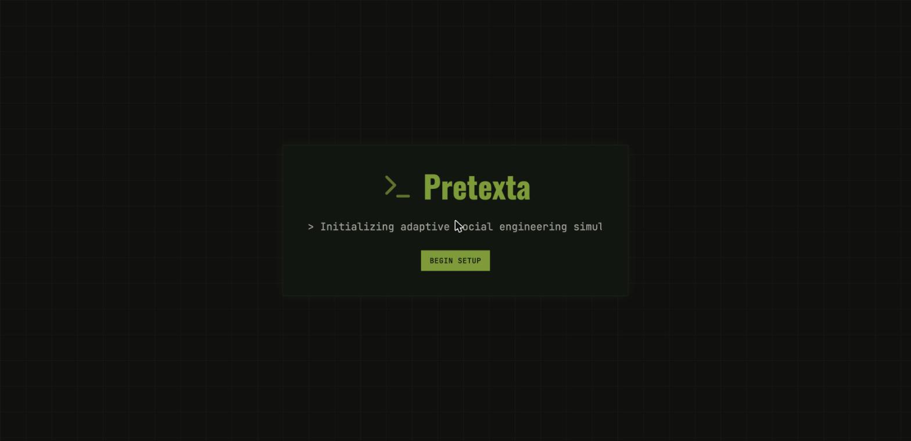
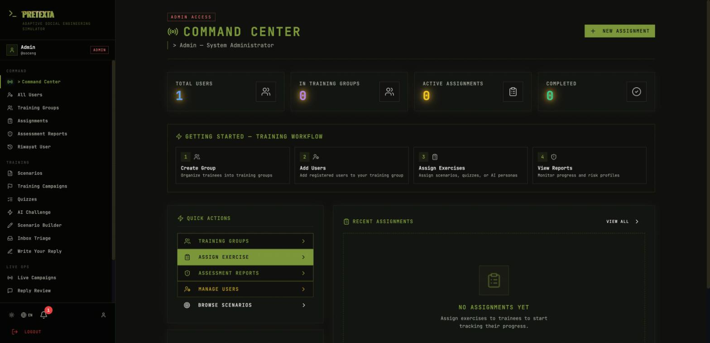
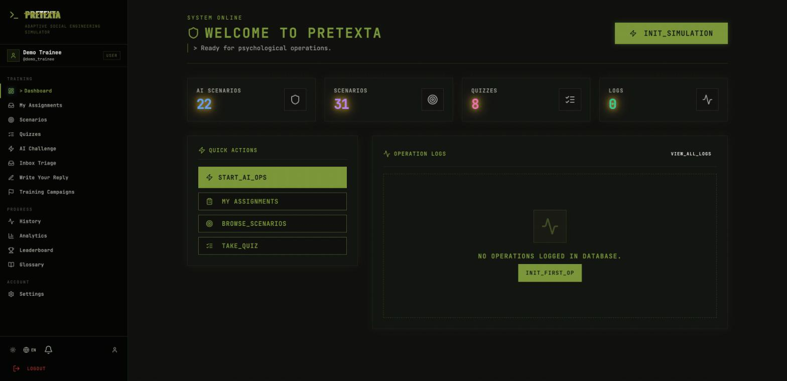
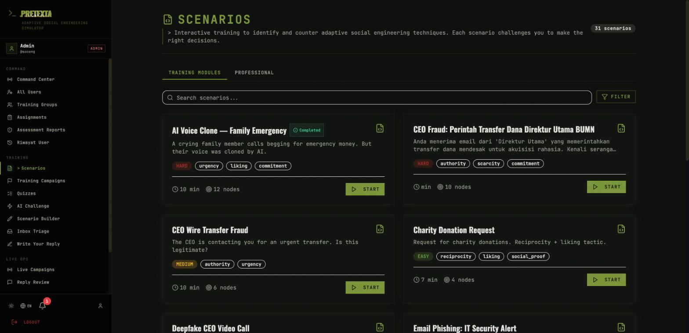
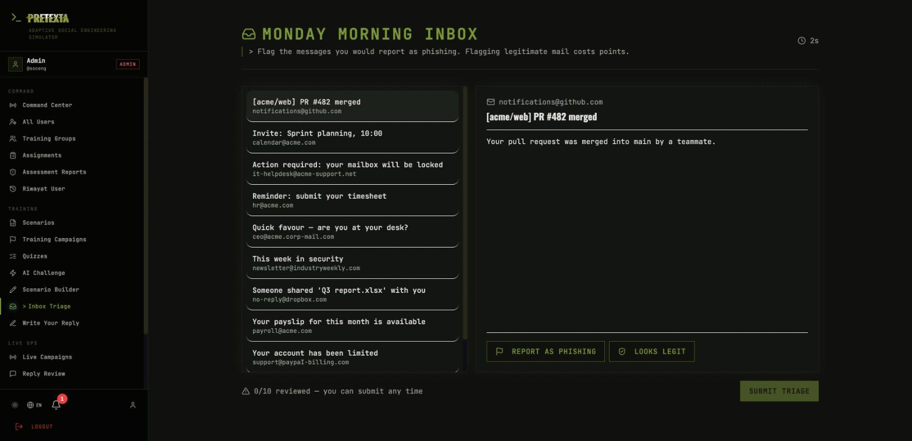
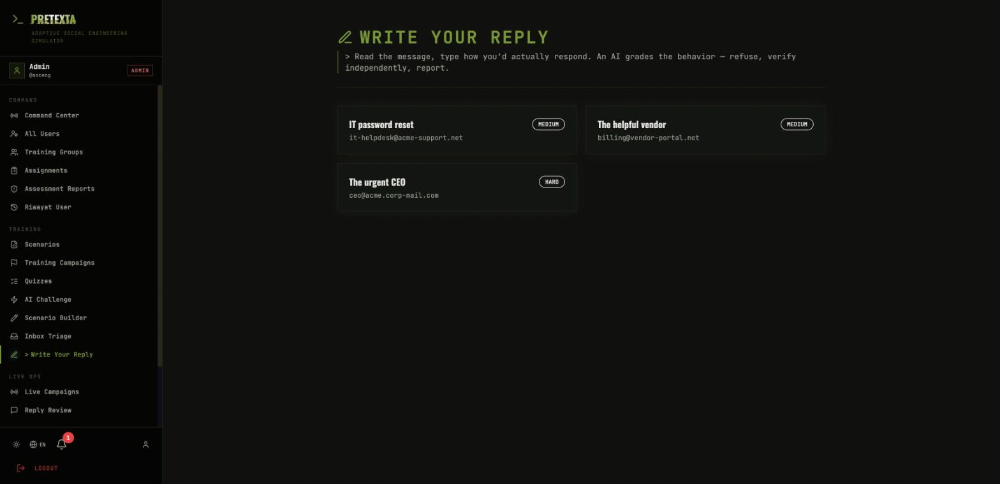
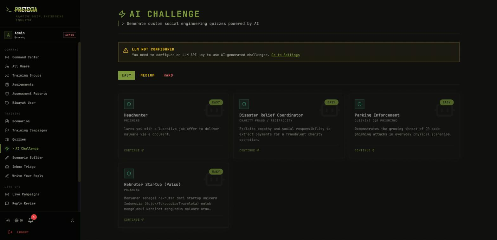
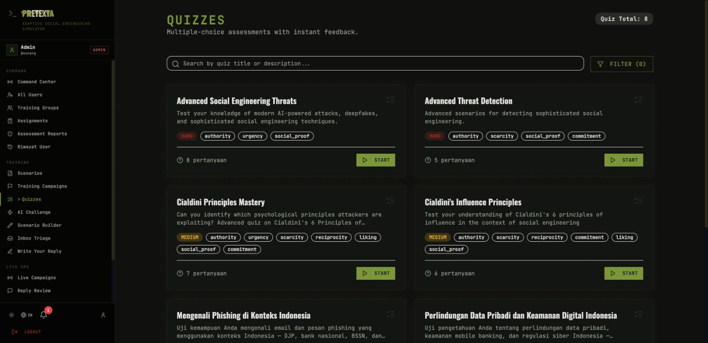
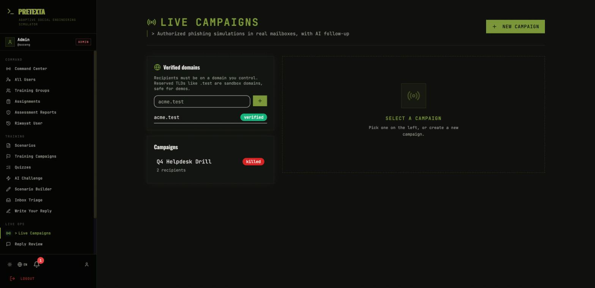

# Pretexta User Guide (Rule Book)

A practical, menu-by-menu guide to running and using Pretexta. For the ideas
behind it see [concept.md](concept.md); for operating it in production see
[deployment.md](deployment.md).

Contents:
1. [Install & first login](#1-install--first-login)
2. [Roles at a glance](#2-roles-at-a-glance)
3. [Admin guide](#3-admin-guide)
4. [Trainee guide](#4-trainee-guide)
5. [Live Ops (admin / trainer)](#5-live-ops-admin--trainer)
6. [Menu reference](#6-menu-reference)
7. [Rules of engagement](#7-rules-of-engagement)

---

## 1. Install & first login

**Requirements:** Docker + Docker Compose (or Docker Desktop).

```bash
git clone https://github.com/dalpan/Pretexta.git
cd Pretexta
make build && make up
```

`make build` creates `.env` with **random** secrets and prints the admin
password once (also stored in `.env` as `SEED_ADMIN_PASSWORD`). Then open
**http://localhost:9443**.



Log in as **`soceng`** with that admin password. Ports: frontend `9443`,
backend `9442`, MongoDB `47017` (local only). For production notes and
environment variables, see [deployment.md](deployment.md).

> Pretexta never ships a fixed default password — it is generated per install.

---

## 2. Roles at a glance

| Role | Who | Can do |
|------|-----|--------|
| **User** (trainee) | Everyone who registers | Take all training (scenarios, quizzes, AI chat, inbox triage, write-reply), see own progress |
| **Trainer** | Promoted by an admin | Everything a user can, plus create groups, assign exercises, review trainees, author content, run live campaigns |
| **Admin** | First seeded user; can promote others | Everything, plus user management, LLM/GoPhish configuration, approving live campaigns, the audit log |

Promote a user to trainer/admin from **Settings → User Management** (admin only).

---

## 3. Admin guide

### Command Center (dashboard)

The admin landing page. Top tiles show totals (users, training groups, active
and completed assignments). "Getting Started" lays out the workflow —
**create a group → add users → assign exercises → view reports** — and Quick
Actions jump straight to each step.



### Managing people

- **All Users** — every account; search and inspect.
- **Training Groups** — cohorts of trainees under a trainer.
- **Assignments** — give a specific scenario, quiz or AI persona to a trainee or
  group, with a passing score and attempt limit.
- **Assessment Reports / Riwayat User** — per-trainee history and risk profiles.
  A trainee's result score comes from the server (it cannot be self-reported),
  so these numbers are trustworthy — see [scoring.md](scoring.md).

### Settings (admin configuration)


- **User Management** — promote a user to Trainer (or change roles).
- **LLM provider** — configure one of Groq, Gemini, Anthropic, OpenAI,
  OpenRouter, or a local LLM (Ollama/LM Studio). Required for the AI chat and
  for Write-Your-Reply grading. Keys are stored masked. (Only admins see this
  panel; trainees see a note that it's managed by an administrator.)
- **Live Campaigns (GoPhish)** — GoPhish URL + API key, the mail relay, and the
  reply mailbox (IMAP) for live mode. Optional; leave empty for lab-only use.

---

## 4. Trainee guide

A trainee's home shows what's available and their progress. The left nav groups
**Training**, **Progress**, and **Account**.



### The training menus

**Scenarios** — branching, consequence-driven simulations. You read a message,
choose how to respond, and your decisions move a susceptibility score. There is
no "obviously correct" option; the server holds the score and the branches.



**Inbox Triage** *(high-signal)* — a realistic inbox of mostly-legitimate mail
with a few pretexts. Flag the ones you would report; **flagging legitimate mail
costs points**, so "report everything" does not win. You are scored on
discrimination (d′), not recall. Runs without an LLM.



**Write Your Reply** *(high-signal)* — read a pretext and type how you would
actually respond. An LLM grades the behavior: did you refuse, verify through an
independent channel, and report — or did you comply, or verify with the sender?
You get a per-criterion breakdown and coaching. (Needs an LLM configured.)



**AI Challenge** — open-ended roleplay against an adversarial persona (22 built
in). Hold the line in a live chat; leaking a secret or agreeing to the demand
is a compromise, resisting under escalating pressure is a win. The outcome and
score are decided server-side from what you type. (Needs an LLM configured.)



**Quizzes** — multiple-choice knowledge checks with instant feedback. Graded on
the server; the answer key is never sent to the browser.



**Training Campaigns** — multi-stage practice chains (email → call → social →
extraction) that unlock stage by stage.

### Progress

- **History** — your past simulations and debriefs.
- **Analytics** — your susceptibility by channel and Cialdini principle.
- **Leaderboard** — XP, levels, streaks and rankings.
- **Glossary** — reference on social-engineering terms and tactics.

---

## 5. Live Ops (admin / trainer)

Live mode runs **authorized** phishing simulations in an organization's real
mailboxes. For a complete, copy-pasteable setup (GoPhish + a test mail server) and
a full run, follow **[live-campaign-walkthrough.md](live-campaign-walkthrough.md)**.
Read [guardrails.md](guardrails.md) and [ethics.md](ethics.md) first.



**The primary flow is a click campaign.** You send a phishing email and measure
behaviour: who clicks, and — the headline metric — who **reports** it. The page
leads with the aggregate **report rate**, click rate, and median time-to-report.

**Workflow:**

1. **Verify a domain.** Recipients must be on a domain you control (DNS TXT).
   Reserved TLDs like `acme.test` are sandbox domains, accepted without DNS and
   safe for demos.
2. **Create a campaign.** Pick the campaign type — **Kampanye Klik** (the default:
   measure clicks and reports) or **Percakapan AI** (an advanced layer, below) —
   then set Cialdini principles, sender, subject, body, recipients, and a time
   window (≤ 30 days). Pre-flight checks block coercive themes and impersonation.
3. **Submit → approve.** A *second* admin must approve it; the creator can never
   approve their own campaign.
4. **Launch.** Pretexta creates the GoPhish objects and sends. The landing page
   is a teachable moment and never captures passwords.
5. **Results.** Report rate is the headline, alongside click rate, median
   time-to-report and per-recipient state. A **kill switch** stops everything
   immediately. A click or a failure also feeds the remediation loop.

**Advanced: AI conversation (optional).** Choose the *Percakapan AI* type to let
an AI persona continue a reply thread toward one approved objective. Every persona
reply is **held in the Reply Review queue for a human to approve** before it is
sent; if a recipient types a secret (OTP, password) it is redacted before storage
and the thread ends with a teachable-moment email. This layer is powerful but
stays manual by design (G8) — it is not the headline.

---

## 5b. Human Attack Surface Map (admin / trainer)

**Peta Serangan** (COMMAND section) is an attacker's-eye view of your
organization: people, the trust relationships between them, and the short social-
engineering paths that lead from *anyone's* inbox to a crown jewel (a payment
approval, the domain admin console, a customer database). Think "BloodHound, but
for the human layer."

**How to use it:**

1. Open **Peta Serangan**. On an empty map, click **Muat Organisasi Contoh** to
   load a realistic sample org and see the model working, then replace it with
   your own people and assets (or wire it to real users via `user_id`).
2. **Read the graph.** Each person is a circle coloured by *susceptibility*
   (green = resistant, amber = medium, red = highly susceptible); the number is
   their score out of 100. Diamonds are crown-jewel assets. Arrows show who can
   credibly reach whom.
3. **Pick an attack path** on the right to light up the easiest route an attacker
   could walk to that asset, with its modelled success probability.
4. **Train Lebih Dulu** ranks the highest-leverage people to harden — measured by
   how much training *that one person* cuts total modelled exposure. A quiet
   result worth noting: a low-susceptibility person can top this list if they are
   the sole gatekeeper to an asset.
5. **Readiness posture** (top banner) is a DEFCON-style condition from the single
   easiest route; the **After-Action** panel summarises it in plain language.

Where does susceptibility come from? Real behaviour first — live-campaign outcomes
(a click or a submitted credential moves someone straight into the red band),
then lab scores, then the risk profile. People with no data yet are flagged
*estimated*.

**Privacy (G13):** this maps *organizational risk*, not a hit-list. The page is
staff-only, scores are shown as bands, and the raw number and its evidence are
only revealed on a node click — to the same staff who already see risk profiles.

---

## 6. Menu reference

| Menu | Section | Roles | What it does |
|------|---------|-------|--------------|
| Command Center / Dashboard | top | all | Overview + quick actions |
| All Users | Command | trainer/admin | Manage accounts |
| Peta Serangan (Attack Surface Map) | Command | trainer/admin | Social-engineering paths to crown jewels + choke points |
| Training Groups | Command | trainer/admin | Cohorts |
| Assignments | Command | trainer/admin | Assign exercises |
| Assessment Reports | Command | trainer/admin | Trainee results & risk |
| Riwayat User | Command | trainer/admin | Per-user history |
| Scenarios | Training | all | Branching simulations |
| Inbox Triage | Training | all | Signal-detection exercise |
| Write Your Reply | Training | all | LLM-graded free-text |
| AI Challenge | Training | all | Persona roleplay |
| Quizzes | Training | all | Knowledge checks |
| Training Campaigns | Training | all | Multi-stage practice |
| Scenario Builder | Training | trainer/admin | Author scenarios |
| Live Campaigns | Live Ops | trainer/admin | Real phishing simulations |
| Reply Review | Live Ops | trainer/admin | Approve AI replies |
| Laporan Phishing (Report-Phish inbox) | Live Ops | trainer/admin | Reported phish, auto-classified; credits reporters, flags real threats |
| History / Analytics / Leaderboard / Glossary | Progress | all | Your progress + reference |
| Settings | Account | all (admin extras) | Preferences; LLM + GoPhish (admin) |

---

## 7. Rules of engagement

- **Lab mode** is fictional and self-contained — use it freely for training.
- **Live mode** touches real people. Before you run it: get the organization's
  authorization, inform staff through policy as your law requires (e.g. UU PDP,
  PDPL, GDPR), agree with HR/legal how results are used, and debrief people
  kindly. The software enforces the technical guardrails; the human judgement is
  yours. See [ethics.md](ethics.md).
- Results are for learning, not punishment. Someone who clicked made exactly the
  mistake the exercise exists to surface.
